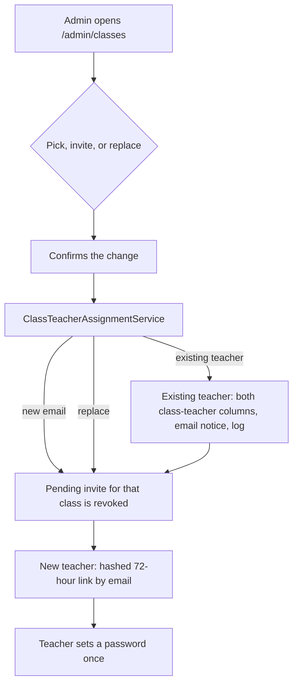

# Class teacher flow

Phase 1 of [`marks-flow.md`](marks-flow.md). One service, `ClassTeacherAssignmentService`, assigns the class teacher. The admin class page, the invite form, the wizard, and Toshi call it. Controllers and Blade views render and authorise. They do not decide who the class teacher is.

## Plan

1. On `/admin/classes` the admin picks an existing teacher, invites a new one, or replaces the current one.
2. Each of those asks for confirmation and writes one `class_teacher` log row, scoped by `school_id` and `section_id`.
3. A new teacher gets an email link. The link stores only a SHA-256 hash, works once, and expires 72 hours after it is issued.
4. Replacing the class teacher, or sending a new invite for that class, revokes any pending invite for the class.
5. `/admin/sections` and `/admin/class-setup` redirect to `/admin/classes`. The class page links the invite form and the stream edit form.
6. Add-class options are the names the school already uses (for example P.1 to P.7). A school with no classes yet uses its type preset.

## Flow

The notice to an existing teacher names who assigned them, which class, and how to raise a mistake. It does not contain a password.

Email is the channel. `staff_invite` is not an approved WhatsApp template, so WhatsApp sending stays off (`invites.staff_whatsapp_enabled`, default false). A test that opens that branch uses a fake. Nothing in this phase calls Meta.

The invite page sends `Referrer-Policy: no-referrer` and a matching meta tag. The raw token is not written to logs, exception reports, or analytics: `InviteTokenScrubber` redacts `/invite/teacher/{token}` and `/invite/co-admin/{token}` before those records are stored. Invite creation and acceptance are rate limited.

The wizard's class-teacher file and Toshi's add-teacher path write the same two columns through this service. Those two paths do not send a second email: the file upload stays silent, and Toshi already sends its own set-password link.
