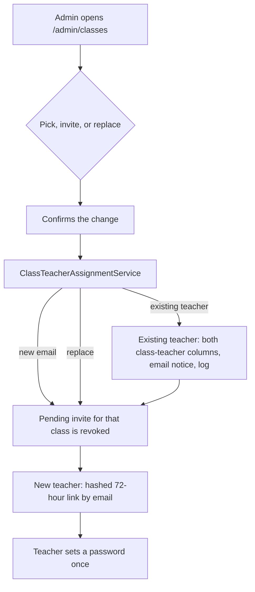

# Class teacher flow

Phase 1 of [`marks-flow.md`](marks-flow.md). One service, `ClassTeacherAssignmentService`, assigns the class teacher. The admin class page, the invite form, the wizard, and Toshi call it. Controllers and Blade views render and authorise. They do not decide who the class teacher is.

## Plan

1. On `/admin/classes` the admin picks an existing teacher, invites a new one, or replaces the current one.
2. Each of those asks for confirmation and writes one `class_teacher` log row, scoped by `school_id` and `section_id`.
3. A new teacher gets an email link. The link stores only a SHA-256 hash, works once, and expires 72 hours after it is issued.
4. Replacing the class teacher, or sending a new invite for that class, revokes any pending invite for the class.
5. `/admin/sections` redirects to `/admin/classes`. `/admin/class-setup` still shows this school's class progress and staff-link approvals. The class page links the invite form and the stream edit form.
6. A school in Uganda is offered the canonical levels (P.1, P.2, … and S.1–S.6, plus nursery), its type preset, and any name it already uses, sorted by level. A school with P.1–P.6 can add P.7. P.10 sorts after P.9, not after P.1. A school in any other country types its own level names.

## Flow

The notice to an existing teacher names who assigned them, which class, and how to raise a mistake. It does not contain a password.

Email is the channel. `staff_invite` is not an approved WhatsApp template, so WhatsApp sending stays off (`invites.staff_whatsapp_enabled`, default false). A test that opens that branch uses a fake. Nothing in this phase calls Meta.

The invite page sends `Referrer-Policy: no-referrer` and a matching meta tag. The raw token is not written to logs, exception reports, or analytics: `InviteTokenScrubber` redacts `/invite/teacher/{token}` and `/invite/co-admin/{token}` before those records are stored. Invite creation and acceptance are rate limited. Each invite link is capped well below that school's cap, so one link runs out first. A token that matches no invite is limited per IP address. Issuing an invite counts against the signed-in admin's school.

The wizard's class-teacher file assigns an existing teacher through this service and does not send an email. Toshi's add-teacher path stores no password. It sends one invite link, and the teacher sets their own password when they open it. A class name attaches that invite to the class. Toshi treats `p7`, `P7`, `P 7`, and `P.7` as the same class, and does not use a partial match. With no class name, the invite is not tied to a class, and claiming it creates the teacher without assigning a class. An email that belongs to a person at another school gets the same invite response as an email this school has never seen. If that person opens the link, the page says the email cannot be used and asks them to contact the school for a different email. It does not name the other school.

`ClassesController@store` saves a class when a Uganda school picks a name `namesForSchool()` offers (canonical levels, the type preset, and names already in use). A name outside that list is a validation error. A school in another country saves the level name it typed. Saving the stream form with the same class teacher leaves a pending invite in place. Changing or clearing the class teacher on that form revokes a pending invite for the class and writes one `class_teacher` log. Clearing the stream teacher also clears the section teacher. An id that is not a teacher in the school, or an assignment with nobody signed in, is a validation error.
