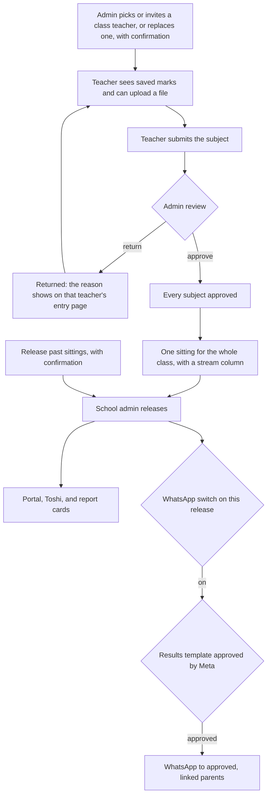
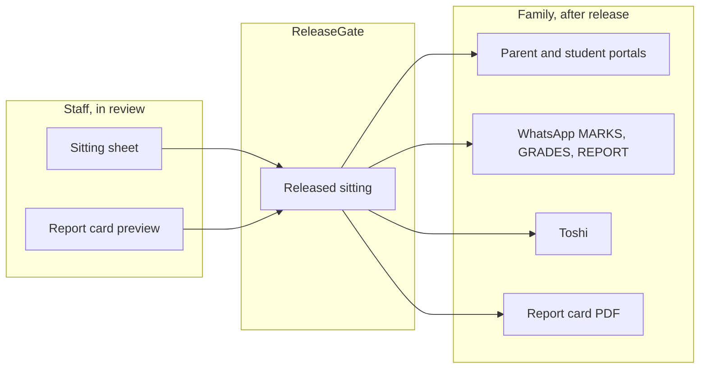

# Marks flow

Status: **Approved by product owner 2026-10-25.** The build waits for the UI audit and a separate approval for each phase. This page does not start a phase.

Audit: [`marks-audit.md`](marks-audit.md), read against `main` at `a6cf68e7`. Older notes checked there: the [#1118](https://github.com/KlassApp-Foundation/KlassApp/pull/1118) proposal, [`docs/dev/marks-flow-open-prs.md`](../dev/marks-flow-open-prs.md), and the October 2026 marks proposals under `docs/proposals/`.

## The flow

One sitting is one exam type in one term for one class. Storage stays one exam row per subject. Every screen groups those rows into the sitting. A whole-term view comes later.

A person confirms every change that other people will rely on. The admin assigns or replaces a class teacher. The teacher submits. The admin approves, or returns the subject with a reason. The school admin releases. A per-school setting can also let the class teacher release that class. Approval of every subject in scope is required. This version has no override.

Parents, students, alumni, Toshi, report-card PDFs sent to a family, and WhatsApp results all read through the release gate. A sitting with no release row stays hidden, including old sittings. Staff can open the sheet and the report card while the sitting is still in review. Those staff pages show "Not released". They are not a parent channel.

When the school's setting allows it, the class teacher uses the same release step for their own class. The WhatsApp switch is visible on the release. It sends only after Meta has approved the results template in the section below. With the switch off, or before that approval, release still opens the portal, Toshi, and report cards, and sends nothing.

Inbound MARKS, GRADES, and REPORT stay behind the gate. The push on release is a separate send, and it uses a template when the 24-hour window is closed.

## Who owns each step

One service owns each behaviour. Controllers and Blade views render and authorise. They do not total, grade, rank, approve, or decide who is the class teacher. The shared engine for numbers is `ResultsService`. The shared engine for "may a family see this" is `ReleaseGate`.

| Step | Person | Service that owns it | Audit rows this step closes |
|---|---|---|---|
| 1. Assign the class teacher | School admin, on the admin dashboard class page | One assignment service. The admin picks an existing teacher or invites a new one, and can replace the current class teacher. Each action asks for confirmation and writes a log entry. The wizard, Toshi, and the invite form call the same service. | T1–T4 |
| 2. Enter or upload marks | Subject teacher, class teacher, or school admin | `ExamMarkWriter` for a typed mark, a corrected mark, a file row, and a Toshi mark. The entry form shows marks already saved. `MarksImportService` keeps the file parse and the preview, then calls the writer. The uploaded file is the spreadsheet path. Google Sheets waits for the connectors work ([#1138](https://github.com/KlassApp-Foundation/KlassApp/pull/1138)). Nursery ratings stay on the ratings form. | E3, E5, E11, D1 |
| 3. Teacher submits | The teacher who entered the subject | `MarksSubmissionService::submit`. One `exam_marks_submissions` row. No parent message. `exams.status` is not the workflow. | S1, S5 |
| 4. Admin approves, or returns with a reason | School admin | `MarksSubmissionService` owns lock, approve, reject, and reopen. A return stores the reason. The entry page shows that reason to the teacher who owns the exam and to school admins. | S3, S4, E6 |
| 5. Combined mark sheet | School admin, and the class teacher for their class | `ResultsService::sheet` for one sitting: one exam type, one term, the whole class. The sheet has a stream column and a stream filter. Missing marks stay blank. They are not zero. A whole-term view is later. | G1–G8, C2, C3 |
| 6. Release | School admin, for any class. A class teacher, for their own class, only when that school's setting is on. | `MarksReleaseService`. Every subject in scope is approved first. There is no override. A sitting with no release row stays hidden. "Release past sittings" is a separate action with a confirmation. | R1, R2, and the parent-visibility table in the audit |
| 7. Report cards | School admin, class teacher for preview. Family only after release. | `StudentReportCardService` reads `ResultsService` for mid-term and end-of-term. Division thresholds and ranking stay as they are until a grading package exists. A family download calls `ReleaseGate` first. | C4–C8, C10, C12, C13 |
| 8. WhatsApp results | School admin, by the switch on that release | `MarksReleaseService` sends to approved, linked parents. Outside the 24-hour window the send is the results template below. Inbound MARKS, GRADES, and REPORT use `ReleaseGate`, then `ResultsService` for the lines and `StudentReportCardService` for the PDF. | R3, C7 |

`GradingSystemService::grade` stays the letter cache on write. The letter a person reads comes from the scale inside `ResultsService`. `Exam::changeExamStatus` goes away once nothing reads `exams.status` as "submitted".

## Rules that already hold, and stay

- Scope every query by `school_id`. A class is a `section_id`. A stream is a `standards_link` row. `standard_id` is the level band.
- Look up a student by id, inside the school. The file import matches the registration number, not the display name.
- One mark write. The teacher form, the single-mark edit, Toshi, and the file import meet in `ExamMarkWriter`.
- One sheet. Staff pages, the release preview, the report card, and the WhatsApp lines meet in `ResultsService`.
- One gate. Family pages and family messages meet in `ReleaseGate`.
- A save is not a release. A submit is not an approval. An approval is not a release.

## Decisions

Approved by the product owner on 2026-10-25. These replace the open questions.

1. **Release.** By default only the school admin releases. A per-school setting can let class teachers release their own class.
2. **Approval.** Approval is always required before release in this version. There is no override.
3. **Real schools and WhatsApp.** On release, WhatsApp results go to approved, linked parents. A per-release switch, visible to the admin, controls that send. The send uses the templates in the repo. A template that is missing or wrong is rewritten and submitted before any real school is messaged. Nothing is sent to a real school until the template that send needs is approved. This page does not submit anything to Meta.
4. **Old sittings.** A sitting with no release row stays hidden until someone releases it. The release screen has a "release past sittings" action, and that action asks for confirmation.
5. **Sheet scope.** The combined sheet is one sitting (one exam type) by default. A whole-term view comes later.
6. **Streams.** A class with streams shows the whole class, with a stream column and a stream filter.
7. **Nursery.** Nursery ratings stay on the ratings form for now.
8. **Spreadsheet.** The uploaded file is enough for now. Google Sheets waits for the connectors work.
9. **Class teacher.** On the dashboard the admin can pick an existing teacher or invite a new one, and can replace a class teacher. Each of those asks for confirmation and writes a log entry.
10. **Division and rank.** Division thresholds and ranking stay as they are until a grading package exists.
11. **Entry form.** The entry form shows marks already saved.
12. **Return reason.** A returned subject shows the reason on the teacher's entry page. That reason is visible only to that teacher and to school admins.

## Phased build

Each phase is one pull request. It starts after the UI audit, and after a separate approval for that phase. Approval of this page is not approval of a phase.

| Phase | What lands | Depends on |
|---|---|---|
| 1 | Class teacher assignment on the admin dashboard: pick an existing teacher, invite a new one, or replace the current one. Confirmation and a log entry on each. One assignment service for the dashboard, the wizard, Toshi, and the invite form. | UI audit, then approval of this phase |
| 2 | The entry form shows saved marks. File import and Toshi entry, including a class teacher, write through `ExamMarkWriter`. Nursery ratings stay on the ratings form. | 1 |
| 3 | `MarksSubmissionService` takes approve, return with a reason, lock, and reopen. The entry page shows the reason to that teacher and to school admins. The queue stops reading `exams.status`. | 2 |
| 4 | The admin marks page is one sitting for the whole class, with a stream column and a stream filter, from `ResultsService`. Remove the filter action that renders without its variables, the PDF that uses the old year lookup, and the second total in the view. | 3 |
| 5 | Report cards take mid-term rows, division, and positions from `ResultsService`, and they honour the school exam-type settings. Division thresholds and the ranking basis stay as they are. Family PDFs stay behind `ReleaseGate`. | 4 |
| 6 | Release: school admin by default, class teacher only where the school setting allows, approval required with no override, and "release past sittings" with a confirmation. The per-release WhatsApp switch is on the release screen. A real-school send waits until the results template below is approved. | 5 |

Later, and not a phase here: a whole-term sheet, Google Sheets through the connectors work, and a grading package for division thresholds and ranking.

## WhatsApp results templates

Checked in the repo on 2026-10-25. Nothing was submitted to Meta, and Meta was not called, so this section does not claim a live approval status.

A message the school starts, such as results on release, can leave the 24-hour window only as an approved template. Free-form text is for a reply inside that window. `WhatsAppBusinessService::sendText` says so (`app/Services/WhatsAppBusinessService.php:109`). `sendTemplate` is the call that can leave the window (`WhatsAppBusinessService.php:177`). `isWithinServiceWindow` is true only when `last_inbound_at` is inside the last 24 hours (`WhatsAppBusinessService.php:272`).

The release job does not use a template. `MarksReleaseService::deliverOne` calls `sendText` (`app/Services/MarksRelease/MarksReleaseService.php:636`) and skips every school that is not a demo (`MarksReleaseService.php:609`). That free-form body cannot carry a real-school release once the window is closed.

The templates defined for submission live in `scripts/submit-whatsapp-message-templates.php`. Language is `services.whatsapp.template_language`, default `en`.

| Name | Category in the script | Variables | Defined | Fits "results released" outside the 24-hour window |
|---|---|---|---|---|
| `fee_update` | UTILITY | `{{1}}` parent name, `{{2}}` student, `{{3}}` balance, `{{4}}` due note, `{{5}}` contact | `scripts/submit-whatsapp-message-templates.php:62` | No. Fees copy. |
| `grade_entered` | UTILITY | `{{1}}` parent name, `{{2}}` subject, `{{3}}` student, `{{4}}` exam label. Footer: "KlassApp — School Management". | `scripts/submit-whatsapp-message-templates.php:82` | No. The body says a new grade for one subject "has been recorded" and tells the parent to reply GRADES. That is a save, not a release of a sitting. UTILITY is the right category for a cold send, and the wording is the wrong event. |
| `report_card_ready` | UTILITY | `{{1}}` parent name, `{{2}}` student, `{{3}}` term label | `scripts/submit-whatsapp-message-templates.php:105` | No. It says the report card is ready and that the PDF will follow in the next message. The next message today is not a template. A PDF sent as free-form text or a document still needs an open window. |
| `health_incident` | UTILITY | Header "Health Center Notice". `{{1}}` parent name, `{{2}}` student, `{{3}}` school, `{{4}}` reason, `{{5}}` contact | `scripts/submit-whatsapp-message-templates.php:123` | No. Health copy. |
| `teacher_account_invite` | MARKETING | `{{1}}` teacher name, `{{2}}` class, `{{3}}` school, `{{4}}` login, `{{5}}` login URL | `scripts/submit-whatsapp-message-templates.php:149`. The same body is in `scripts/retry-rejected-whatsapp-templates.php:35` and `scripts/retry-rejected-whatsapp-templates-en-us.php`. | No. A staff invite, and MARKETING is the wrong category for results. |
| `toshi_otp` | AUTHENTICATION | Meta's OTP body, a 5-minute footer, and a copy-code button. No custom results variables. | `scripts/submit-whatsapp-message-templates.php:171`. Retried from the same two retry scripts. | No. A login code. |

`knowledge.md` also names `klassapp_otp` as an authentication template. The submit script does not define it. It is not a results template.

**What is missing.** A UTILITY template whose body is a release notice, with a fixed set of variables: parent name, student name, sitting label, school name. The body tells the parent that the school has released that sitting and to reply GRADES to see the marks. The mark lines stay a reply inside the window that reply opens, which is the path `ReleaseGate` already guards. `grade_entered` is not that template, and it must not be reused: it announces a recorded grade.

`report_card_ready` is also not enough for a report-card PDF outside the window, because it promises the PDF in a later message. A PDF the school pushes while the window is closed needs its own approved template, with the document on the template, or it waits until the parent replies and the window opens.

Until that results template is approved, the per-release switch can be on and the release can still open the portal, Toshi, and report cards. The WhatsApp send to a real school does not go out. Demo sends are unchanged until that phase is approved. This change does not submit or rewrite a template at Meta.
