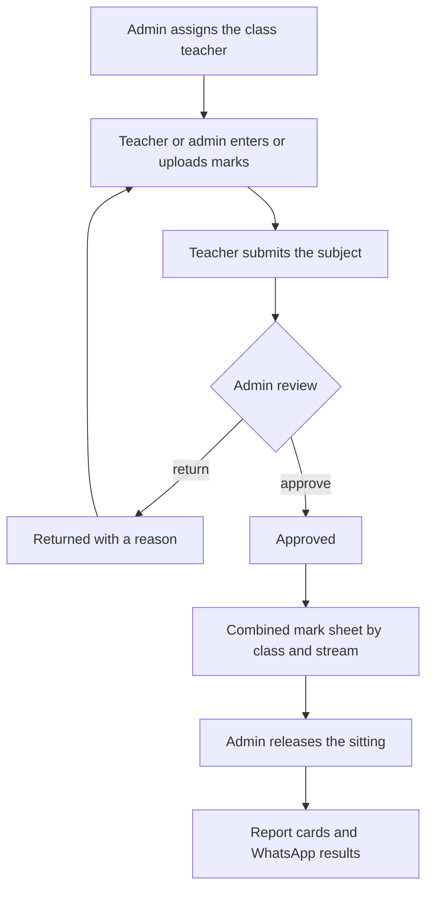
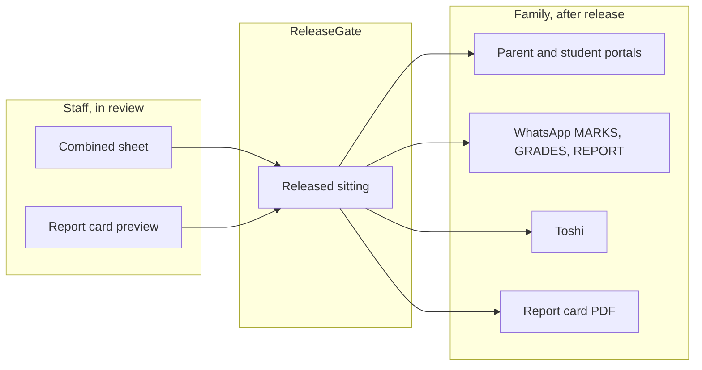

# Marks flow

Status: **awaiting the product owner's approval.** This is a spec. Do not build it from this page.

Audit: [`marks-audit.md`](marks-audit.md), read against `main` at `a6cf68e7`. Older notes checked there: the [#1118](https://github.com/KlassApp-Foundation/KlassApp/pull/1118) proposal, [`docs/dev/marks-flow-open-prs.md`](../dev/marks-flow-open-prs.md), and the October 2026 marks proposals under `docs/proposals/`.

## The flow

One sitting is one exam type in one term for one class. Storage stays one exam row per subject. Every screen groups those rows into the sitting.

A person confirms every change that other people will rely on. The teacher submits. The admin approves, or returns the sitting with a reason. The admin releases. Nobody else sees or receives results before that release. Assigning a class teacher is its own confirmation on the admin dashboard.

Parents, students, alumni, Toshi, report-card PDFs sent to a family, and WhatsApp results all read through the release gate. Staff can open the sheet and the report card while the sitting is still in review. Those staff pages show a "Not released" state. They are not a parent channel.

## Who owns each step

One service owns each behaviour. Controllers and Blade views render and authorise. They do not total, grade, rank, approve, or decide who is the class teacher. The shared engine for numbers is `ResultsService`. The shared engine for "may a family see this" is `ReleaseGate`.

| Step | Person | Service that owns it | Audit rows this step closes |
|---|---|---|---|
| 1. Assign the class teacher | School admin, on the admin dashboard class page | One assignment service. Today the write is split across the onboarding wizard, Toshi, `ClassTeacherInviteService`, and the legacy stream form. The dashboard roster only displays the name. | T1–T4 |
| 2. Enter or upload marks | Subject teacher, class teacher, or school admin | `ExamMarkWriter` for a typed mark, a file row, a nursery rating, and a Toshi mark. `MarksImportService` keeps preview and the file parse, then calls the writer. A Google Sheets import, if the product owner wants it, calls the same writer. Draft [#1138](https://github.com/KlassApp-Foundation/KlassApp/pull/1138) is not this spec. | E5, E11, E13, D1 |
| 3. Teacher submits | The teacher who entered the subject | `MarksSubmissionService::submit`. One `exam_marks_submissions` row. No parent message. `exams.status` is not the workflow. | S1, S5 |
| 4. Admin approves, or returns with a reason | School admin | `MarksSubmissionService` also owns lock, approve, reject, and reopen. The reason is required on a return and is stored on the submission. | S3, S4 |
| 5. Combined mark sheet | School admin, and the class teacher for their class | `ResultsService::sheet` for one class and, when a stream is selected, one stream. The grid, the class page, the per-student page, the PDF, and both workbooks call it. Missing marks stay blank. They are not zero. | G1–G8, C2, C3 |
| 6. Release | School admin. Whether a class teacher may release their own class is an open question. | `MarksReleaseService`. Release waits until every subject in scope is approved. An admin override is a reason, logged. | R1, R2, and the parent-visibility table |
| 7. Report cards | School admin, class teacher for preview. Family only after release. | `StudentReportCardService` reads `ResultsService` for mid-term and end-of-term. A family download calls `ReleaseGate` first. | C4–C8, C10, C12 |
| 8. WhatsApp results | Sent because an admin released, not because a teacher saved. | `MarksReleaseService` for the push. Inbound MARKS, GRADES, and REPORT use `ReleaseGate`, then `ResultsService` for the lines and `StudentReportCardService` for the PDF. | R3, C7, parent-visibility table |

`GradingSystemService::grade` stays the letter cache on write. The letter a person reads comes from the scale inside `ResultsService`. `Exam::changeExamStatus` goes away once nothing reads `exams.status` as "submitted".

## Rules that already hold, and stay

- Scope every query by `school_id`. A class is a `section_id`. A stream is a `standards_link` row. `standard_id` is the level band.
- Look up a student by id, inside the school. The file import matches the registration number, not the display name.
- One mark write. The teacher form, the single-mark edit, Toshi, and the file import meet in `ExamMarkWriter`.
- One sheet. Staff pages, the release preview, the report card, and the WhatsApp lines meet in `ResultsService`.
- One gate. Family pages and family messages meet in `ReleaseGate`.
- A save is not a release. A submit is not an approval. An approval is not a release.

## Phased build

Each phase is one pull request after this spec is approved. No phase starts from this document alone.

| Phase | What lands | Depends on |
|---|---|---|
| 0 | Product owner answers the open questions and approves this page. | — |
| 1 | Class teacher assignment on the admin dashboard class page, through one service. The wizard, Toshi, and the invite form call that service. | 0 |
| 2 | `ExamMarkWriter` takes the nursery save, the file import, and the class-teacher Toshi path. | 0 |
| 3 | `MarksSubmissionService` takes approve, reject with a reason, lock, and reopen. The queue stops reading `exams.status`. | 2 |
| 4 | The admin marks page is the combined sheet from `ResultsService`. Remove the filter action that renders without its variables, the PDF that uses the old year lookup, and the second total in the view. | 3 |
| 5 | Report cards take mid-term rows, division, and positions from `ResultsService`, and they honour the school exam-type settings. Family PDFs stay behind `ReleaseGate`. | 4 |
| 6 | WhatsApp push on release for a real school, only if the product owner turns that switch on. Inbound keywords already use the gate. | 5 |

Google Sheets, entry-form prefill, and a class-grid spreadsheet (one column per subject) wait on their own questions below. They are not a phase until the product owner adds them.

## Open questions

For the product owner. The build does not pick these.

1. May a class teacher release their own class, or only a school admin?
2. May an admin release before every subject is approved, with a logged reason, or is approval always required?
3. When a real school releases, do parents get a WhatsApp message, or does release only unlock the portal, Toshi, and a report the parent asks for?
4. For schools that already have old marks and no release rows, should those past sittings be marked released, or stay hidden until someone releases them?
5. Is the combined sheet one sitting (one exam type) or the whole term?
6. For a class with streams, is the sheet one stream at a time, or the whole class with a stream column?
7. Do nursery ratings sit on this sheet, or stay on the ratings form until a later spec?
8. Is Google Sheets in scope, or is the uploaded file enough? [#1138](https://github.com/KlassApp-Foundation/KlassApp/pull/1138) is a separate draft.
9. On the dashboard, does the admin pick an existing teacher, send an invite, or both? Can they replace a class teacher who is already set?
10. Do division thresholds and the ranking basis (total or aggregate) stay as they are until a grading package exists?
11. Should the entry form show saved marks, or stay blank until the prefill note is accepted?
12. Should a returned subject name the reason on the teacher's entry page, and who else can see that reason?
