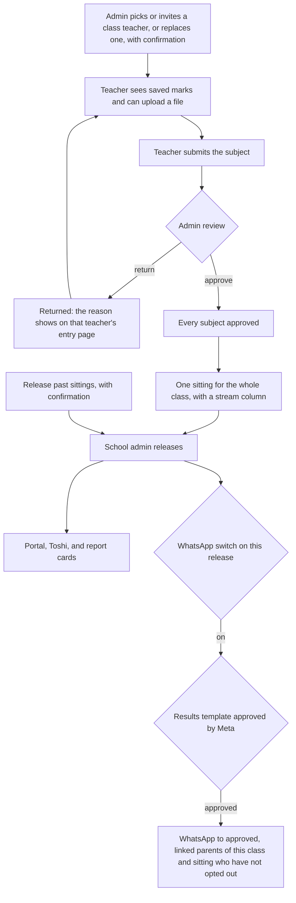
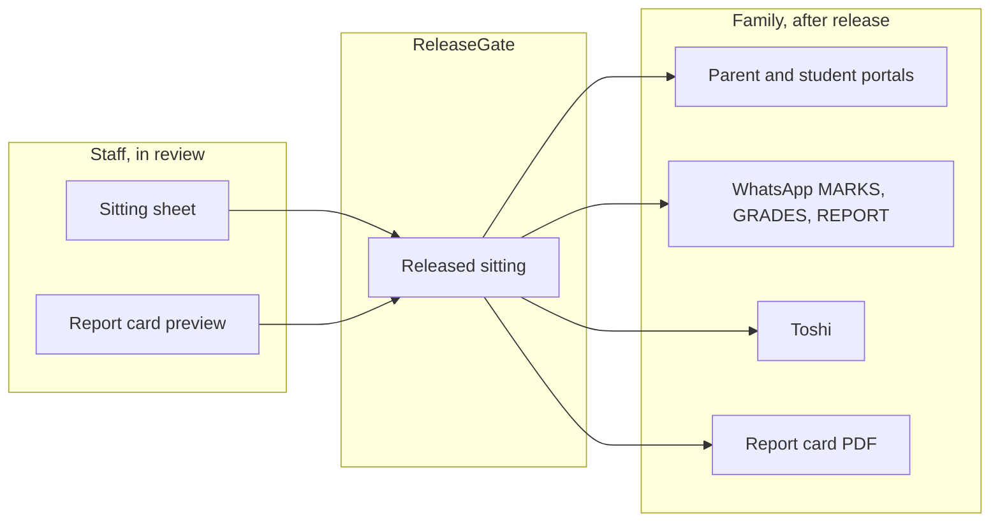
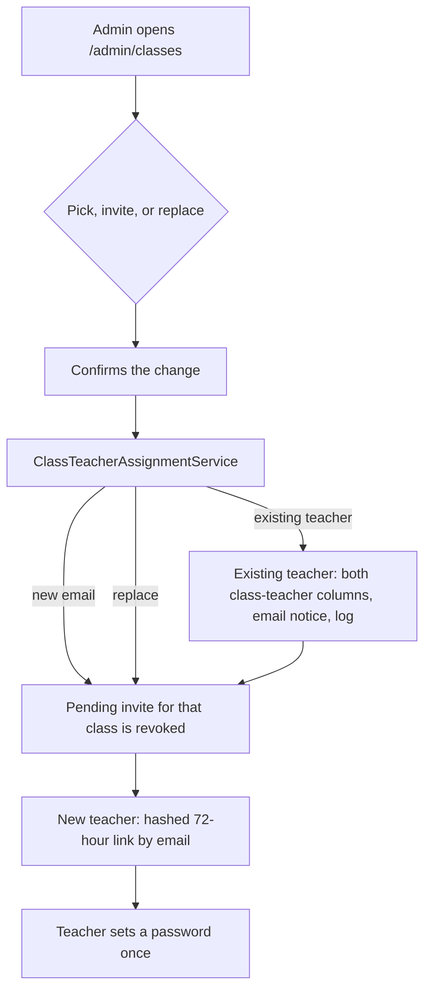
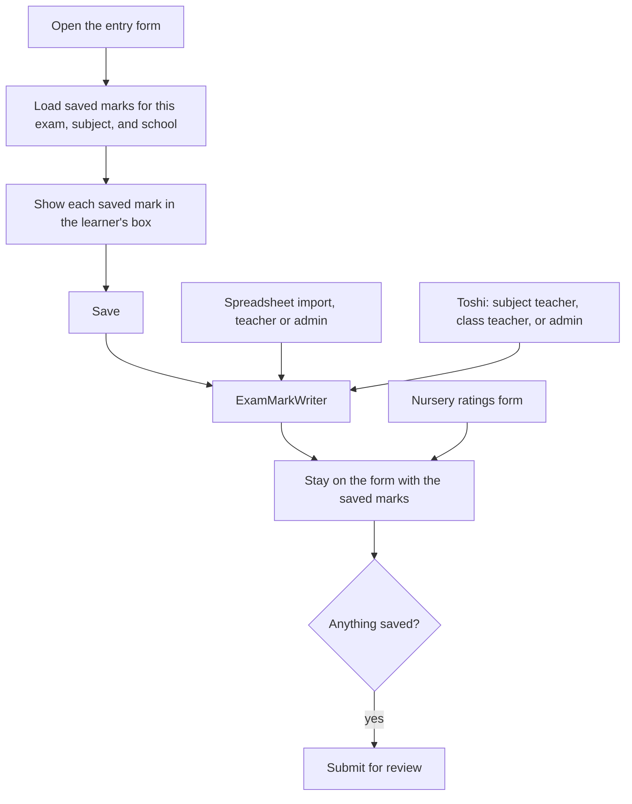
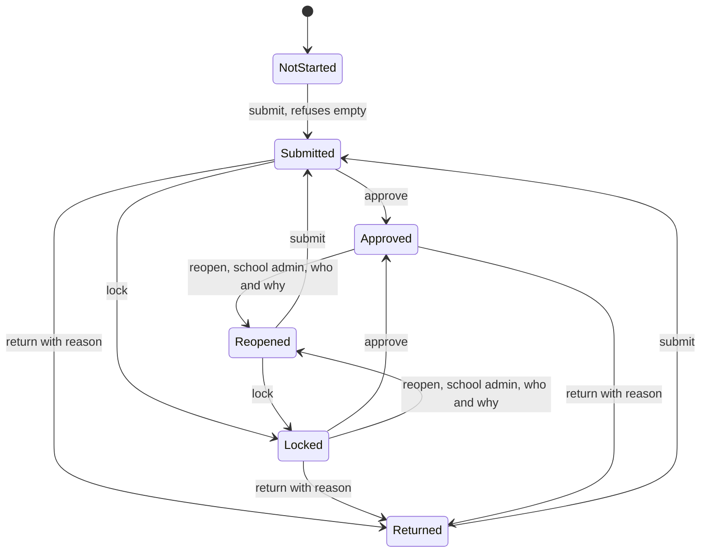
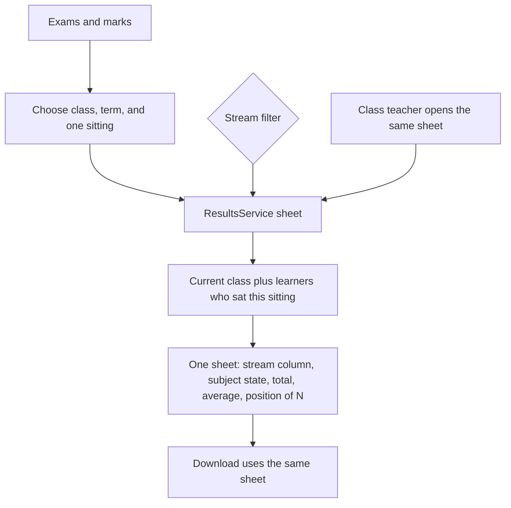
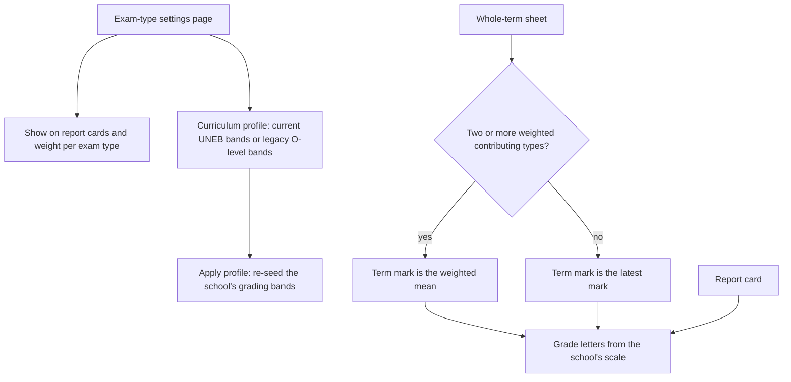

# Marks flow

Status: **Approved by product owner 2026-10-25.** The build waits for the UI audit and a separate approval for each phase. This page does not start a phase.

Audit: [`marks-audit.md`](marks-audit.md), read against `main` at `a6cf68e7`. Older notes checked there: the [#1118](https://github.com/KlassApp-Foundation/KlassApp/pull/1118) proposal, [`docs/dev/marks-flow-open-prs.md`](../dev/marks-flow-open-prs.md), and the October 2026 marks proposals under `docs/proposals/`.

## The flow

One sitting is one exam type in one term for one class. Storage stays one exam row per subject. Every screen groups those rows into the sitting. A whole-term view comes later.

A person confirms every change that other people will rely on. The admin assigns or replaces a class teacher. The teacher submits. The admin approves, or returns the subject with a reason. The school admin releases. A per-school setting can also let the class teacher release that class. Approval of every subject in scope is required. This version has no override.

Parents, students, alumni, Toshi, report-card PDFs sent to a family, and WhatsApp results all read through the release gate. A sitting with no release row stays hidden, including old sittings. Staff can open the sheet and the report card while the sitting is still in review. Those staff pages show "Not released". They are not a parent channel.

When the school's setting allows it, the class teacher uses the same release step for their own class. The WhatsApp switch is visible on the release. A WhatsApp results send only happens once the template it uses is approved by Meta. A parent who has opted out of WhatsApp results gets none. A release only messages approved, linked parents of the students in the released class and sitting, never the whole school. With the switch off, or before that approval, release still opens the portal, Toshi, and report cards, and sends nothing.

Inbound MARKS, GRADES, and REPORT stay behind the gate. The "See results" quick reply is handled exactly like GRADES. The push on release is a separate send. A WhatsApp results send only happens once the template it uses is approved by Meta. A parent who has opted out of WhatsApp results gets none. A release only messages approved, linked parents of the students in the released class and sitting, never the whole school. It uses a template when the 24-hour window is closed.

## Who owns each step

One service owns each behaviour. Controllers and Blade views render and authorise. They do not total, grade, rank, approve, or decide who is the class teacher. The shared engine for numbers is `ResultsService`. The shared engine for "may a family see this" is `ReleaseGate`.

| Step | Person | Service that owns it | Audit rows this step closes |
|---|---|---|---|
| 1. Assign the class teacher | School admin, on the admin dashboard class page | One assignment service. The admin picks an existing teacher or invites a new one, and can replace the current class teacher. Each action asks for confirmation and writes a log entry. The wizard, Toshi, and the invite form call the same service. | T1–T4 |
| 2. Enter or upload marks | Subject teacher, class teacher, or school admin | `ExamMarkWriter` for a typed mark, a corrected mark, a file row, and a Toshi mark. The entry form shows marks already saved. `MarksImportService` keeps the file parse and the preview, then calls the writer. The uploaded file is the spreadsheet path. Google Sheets waits for the connectors work ([#1138](https://github.com/KlassApp-Foundation/KlassApp/pull/1138)). Nursery ratings stay on the ratings form. | E3, E5, E11, D1 |
| 3. Teacher submits | The teacher who entered the subject | `MarksSubmissionService::submit`. One `exam_marks_submissions` row. No parent message. `exams.status` is not the workflow. | S1, S5 |
| 4. Admin approves, or returns with a reason | School admin | `MarksSubmissionService` owns lock, approve, reject, and reopen. A return stores the reason. The entry page shows that reason to the teacher who owns the exam and to school admins. | S3, S4, E6 |
| 5. Combined mark sheet | School admin, and the class teacher for their class | `ResultsService::sheet` for one sitting: one exam type, one term, the whole class. The sheet has a stream column and a stream filter. Missing marks stay blank. They are not zero. A whole-term view is later. | G1–G8, C2, C3 |
| 6. Release | School admin, for any class. A class teacher, for their own class, only when that school's setting is on. | `MarksReleaseService`. Every subject in scope is approved first. There is no override. A sitting with no release row stays hidden. "Release past sittings" is a separate action with a confirmation. A WhatsApp results send only happens once the template it uses is approved by Meta. A parent who has opted out of WhatsApp results gets none. A release only messages approved, linked parents of the students in the released class and sitting, never the whole school. | R1, R2, and the parent-visibility table in the audit |
| 7. Report cards | School admin, class teacher for preview. Family only after release. | `StudentReportCardService` reads `ResultsService` for mid-term and end-of-term. Division thresholds and ranking stay as they are until a grading package exists. A family download calls `ReleaseGate` first. | C4–C8, C10, C12, C13 |
| 8. WhatsApp results | School admin, by the switch on that release | `MarksReleaseService`. A WhatsApp results send only happens once the template it uses is approved by Meta. A parent who has opted out of WhatsApp results gets none. A release only messages approved, linked parents of the students in the released class and sitting, never the whole school. Outside the 24-hour window the send is `results_released` below. The "See results" quick reply is handled exactly like GRADES. Inbound MARKS, GRADES, and REPORT use `ReleaseGate`, then `ResultsService` for the lines and `StudentReportCardService` for the PDF. No real school gets the send until `results_released` is approved and the admin's per-release switch is on. | R3, C7 |

`GradingSystemService::grade` stays the letter cache on write. The letter a person reads comes from the scale inside `ResultsService`. `Exam::changeExamStatus` goes away once nothing reads `exams.status` as "submitted".

## Rules that already hold, and stay

- Scope every query by `school_id`. A class is a `section_id`. A stream is a `standards_link` row. `standard_id` is the level band.
- Look up a student by id, inside the school. The file import matches the registration number, not the display name.
- One mark write. The teacher form, the single-mark edit, Toshi, and the file import meet in `ExamMarkWriter`.
- One sheet. Staff pages, the release preview, the report card, and the WhatsApp lines meet in `ResultsService`.
- One gate. Family pages and family messages meet in `ReleaseGate`.
- A save is not a release. A submit is not an approval. An approval is not a release.

## Decisions

Approved by the product owner on 2026-10-25. These replace the open questions.

1. **Release.** By default only the school admin releases. A per-school setting can let class teachers release their own class.
2. **Approval.** Approval is always required before release in this version. There is no override.
3. **Real schools and WhatsApp.** A per-release switch, visible to the admin, controls the WhatsApp send. A WhatsApp results send only happens once the template it uses is approved by Meta. A parent who has opted out of WhatsApp results gets none. A release only messages approved, linked parents of the students in the released class and sitting, never the whole school. The send uses `results_released` (UTILITY, English, submitted to Meta, pending approval). No real school gets the send until that template is approved and the admin's per-release switch is on.
4. **Old sittings.** A sitting with no release row stays hidden until someone releases it. The release screen has a "release past sittings" action, and that action asks for confirmation.
5. **Sheet scope.** The combined sheet is one sitting (one exam type) by default. A whole-term view comes later.
6. **Streams.** A class with streams shows the whole class, with a stream column and a stream filter.
7. **Nursery.** Nursery ratings stay on the ratings form for now.
8. **Spreadsheet.** The uploaded file is enough for now. Google Sheets waits for the connectors work.
9. **Class teacher.** On the dashboard the admin can pick an existing teacher or invite a new one, and can replace a class teacher. Each of those asks for confirmation and writes a log entry.
10. **Division and rank.** Division thresholds and ranking stay as they are until a grading package exists.
11. **Entry form.** The entry form shows marks already saved.
12. **Return reason.** A returned subject shows the reason on the teacher's entry page. That reason is visible only to that teacher and to school admins.
13. **Report composition.** Each exam type has a "show on report cards" switch and an optional weight on the exam-type settings page. A type switched off does not appear as a column on a report card and does not appear as a sitting on a whole-term sheet, but the totals still follow the contributes-to-total flags. When two or more contributing types carry weights, the term mark for a subject is the weighted mean of the marks the learner has; otherwise the latest mark wins. Weights only merge on a whole-term view, never inside one sitting.
14. **Curriculum profile.** Each school picks a curriculum profile on the exam-type settings page. The profile decides which grading bands the school's own scale is seeded with: the current UNEB bands, or the legacy O-level scale kept for schools that still use it. Applying a profile re-seeds the school's scale. The current UNEB bands and the A-level bands live in one config file so a later grading package can take them over.

    **The legacy O-level scale belongs to the school.** UNEB never published its pre-NLSC cut-offs as one fixed national table, so there is nothing to copy faithfully: the school owns the boundaries and edits them on the exam-type settings page. The D1–F9 letters and their 1–9 points are fixed; only the marks move. The table in `config/grading_uganda.php` (`o-level-legacy`) is a labelled example shown until the school saves its own, not a national standard and not a claim about what UNEB used.

## Phased build

Each phase is one pull request. It starts after the UI audit, and after a separate approval for that phase. Approval of this page is not approval of a phase. The screen gaps from [`marks-ui-audit.md`](marks-ui-audit.md) are in the rows below. They follow the decisions above.

| Phase | What lands | Depends on |
|---|---|---|
| 1 | Class teacher assignment on the admin dashboard: pick an existing teacher, invite a new one, or replace the current one. Confirmation and a log entry on each. One assignment service for the dashboard, the wizard, Toshi, and the invite form. The control is on `/admin/classes`, including replacing a teacher who is already set. `/admin/sections` and `/admin/class-setup` redirect there. The class page links the invite and the stream form. Class names come from the school's own sections. The invite link is hashed, single-use, and expires in 72 hours. The flow is in [`class-teacher-flow.md`](class-teacher-flow.md). | UI audit, then approval of this phase |
| 2 | The entry form shows saved marks and stays on the page after save. Submit for review is absent until there is something to submit. Upcoming exams either counts those exams or is renamed. File import and Toshi entry, including a class teacher, write through `ExamMarkWriter`. Nursery ratings stay on the ratings form. | 1 |
| 3 | `MarksSubmissionService` takes approve, return with a reason, lock, and reopen. Lock, Return, and Approve each post their own form. The word on the return is Return, and that reason is on the teacher's entry page. The view does not say Unmarked work after a submit. The queue and the exam list use the submission row, and the queue stops reading `exams.status`. The heading names the class, not the level band. | 2 |
| 4 | The admin marks page is one sitting for the whole class, with a stream column and a stream filter, from `ResultsService`. Exams and marks opens that sheet. A streamed class (P.7 A/B, S.1 East/West) uses that column and filter. The teacher's Combined Marksheet opens the same sheet. Remove the filter action that renders without its variables, the PDF that uses the old year lookup, and the second total in the view. | 3 |
| 5 | Report cards take mid-term rows, division, and positions from `ResultsService`, and they honour the school exam-type settings. Division thresholds and the ranking basis stay as they are. Report cards keep the stream split they already have, and the sheet in phase 4 uses the same split. Family PDFs stay behind `ReleaseGate`. | 4 |
| 6 | Release: school admin by default, class teacher only where the school setting allows, approval required with no override, and "release past sittings" with a confirmation. The per-release WhatsApp switch is on the release screen. The release messages the approved, linked parent. The empty MARKS reply is one line per child, not an extra line that no child has results. The position's "of" count uses the same pool as the sheet. A real-school send waits until the results template below is approved. A WhatsApp results send only happens once the template it uses is approved by Meta. A parent who has opted out of WhatsApp results gets none. A release only messages approved, linked parents of the students in the released class and sitting, never the whole school. No real school gets the send until `results_released` is approved and the admin's per-release switch is on. | 5 |

Later, and not a phase here: a whole-term sheet, Google Sheets through the connectors work, and a grading package for division thresholds and ranking.

### Phase 1 flow

The build notes, the confirmation rule, and the invite rules are in [`class-teacher-flow.md`](class-teacher-flow.md).

### Phase 2 flow

The entry form loads marks already saved for this exam, this subject, and this school, and puts each one in that learner's box. A validation error keeps what the person just typed. Save stays on this page. Submit for review is absent until a numeric mark is saved, or until a nursery rating is saved. Nursery ratings stay on the ratings form and do not go through `ExamMarkWriter`.

Every numeric entry path writes one row through `ExamMarkWriter`: the entry form, the single-mark edit, the teacher spreadsheet import, the admin spreadsheet import (the same service), and Toshi for a subject teacher, a class teacher, or a school admin. The writer checks the school, the learner, and whether this subject is open. A submitted, approved, or locked subject stays closed until a school admin returns or reopens it. It stores the letter. It does not change the exam status and it does not message parents. The import still parses and previews the file, then calls the writer, and it still moves an undone exam to done. A class teacher may enter a mark in Toshi when `ExamAuthorization` already allows that person on the form.

The Upcoming Exams tile counts the open exams this person can mark (`undone` or `done` for their exams or their class). It still links to the marks list. There is no second writer for a teacher who marks more than one class: each exam on that list uses the same form and the same writer.

### Phase 3 flow

`MarksSubmissionService` owns one class, one subject, and one sitting. `exams.status` is not this workflow. Submit, approve, return, lock, and reopen all go through the service. Each one checks the school, checks that a school admin is reviewing (or that `ExamAuthorization` already allowed the teacher to submit), and writes a log with the actor and the time.

Submit refuses an empty subject. It is allowed when there is no row, and again after a return or a reopen. It sets the row to submitted and the approval to pending. It does not change `exams.status`. School admins get an in-app notice.

Approve is a school admin action on a submitted or locked row that is still pending. It does not wait for a lock. The approved state is what a later release reads. The release screen still has an admin override until phase 6.

Return is a school admin action on a submitted, locked, or approved row. The reason is required, from 10 to 500 characters. The stored values are `reopened` and `rejected`, because those are the existing status values. The screen says Returned. The reason is on the entry page for the exam's teacher and for a school admin of that school.

Lock is a school admin action on a draft, submitted, or reopened row that is not already approved. An approved row is not locked again. A passed deadline uses the same lock.

Reopen is a school admin action on a locked or approved row. It records who and why, sets the row to reopened, and sets approval back to pending. The marks can be edited, and a release waits for a new approval.

`ExamMarkWriter` refuses a save while the row is submitted, approved, or locked, including a legacy exam whose `exams.status` is submitted and whose submission row is not open. A return or a reopen is what opens the marks. A correction reason does not.

Notices use the in-app bell. They do not send WhatsApp.

On the review page, Lock, Return, and Approve each post their own form. Approve is on a submitted row. An approved row does not offer Lock. The heading names the class (the section), not the level band. The queue lists submitted or locked rows that are still pending. Both exam lists show the same label: Not started, Submitted, Returned, Approved, Locked, or Reopened.

The writer allows Not started, Returned, and Reopened. The writer refuses Submitted, Approved, and Locked.

### Phase 4 flow

Exams and marks opens one combined sheet. The person chooses a class, a term, and one sitting (one exam type). A whole-term sheet is later. The sheet is the whole class. A class with streams has a stream column and a stream filter. Whole class is the default. A chosen stream narrows the rows.

`ResultsService` is the only place that works out the total, the average, the aggregate, the position, and the "of" count. The page and the download print those fields. A stream filter uses that stream's position and its "of" count. The whole class uses the class position and the class "of" count. The same pool is what a later release reads.

Each subject column shows the Phase 3 submission state for that subject: Not started, Submitted, Returned, Approved, Locked, or Reopened.

The learners are the ones enrolled in that class for the term, plus anyone who has a mark on that sitting. An in-place promotion moves the academic row, so the old class is no longer their current section. The sitting still lists them from the marks. When the class had one stream, that stream stays on the row. When it had more than one, the old stream was not stored, so the stream cell is blank and a stream filter does not include them. They stay on the whole-class sheet.

The teacher's Combined Marksheet opens this same sheet for a class they hold or a class where they have an exam. The download of this sheet is the same `ResultSheet`. The older term workbook download is unchanged.

The old filter action that rendered the page without its variables is no longer the address. The PDF that looked up the year by the description "Current Academic Year" is no longer the download. The grid does not add the marks up a second time.

Before a phone can be used for any phase, the menu button and the search button each take their own tap ([#1159](https://github.com/KlassApp-Foundation/KlassApp/pull/1159)).

### Phase 5 flow

The school admin sets the report composition and the curriculum profile on the exam-type settings page. The composition decides which exam types a report card shows and how a whole-term view merges the marks of several sittings. The profile decides which grading bands the school's own scale is seeded with. Report cards and the combined sheet read both settings through the same results service, so a type the school hides disappears everywhere, and the grade letters stay the school's own.

The old (pre-NLSC) O-level scale is edited by the school on the same page. There is no national legacy table to ship: the example is a starting point, the letters and points are fixed, and the school's saved boundaries are what its reports use. A school that never saves its own table keeps working on the example, labelled as one.

## WhatsApp results templates

Checked in the repo on 2026-10-25. That check found no results-released template in `scripts/submit-whatsapp-message-templates.php`. `results_released` has since been submitted to Meta. It is UTILITY, English, and pending approval. This section does not claim Meta has approved it.

A message the school starts, such as results on release, can leave the 24-hour window only as an approved template. Free-form text is for a reply inside that window. `WhatsAppBusinessService::sendText` says so (`app/Services/WhatsAppBusinessService.php:109`). `sendTemplate` is the call that can leave the window (`WhatsAppBusinessService.php:177`). `isWithinServiceWindow` is true only when `last_inbound_at` is inside the last 24 hours (`WhatsAppBusinessService.php:272`).

The release job does not use a template. `MarksReleaseService::deliverOne` calls `sendText` (`app/Services/MarksRelease/MarksReleaseService.php:636`) and skips every school that is not a demo (`MarksReleaseService.php:609`). That free-form body cannot carry a real-school release once the window is closed.

The templates defined for submission live in `scripts/submit-whatsapp-message-templates.php`. Language is `services.whatsapp.template_language`, default `en`.

| Name | Category in the script | Variables | Defined | Fits "results released" outside the 24-hour window |
|---|---|---|---|---|
| `fee_update` | UTILITY | `{{1}}` parent name, `{{2}}` student, `{{3}}` balance, `{{4}}` due note, `{{5}}` contact | `scripts/submit-whatsapp-message-templates.php:62` | No. Fees copy. |
| `grade_entered` | UTILITY | `{{1}}` parent name, `{{2}}` subject, `{{3}}` student, `{{4}}` exam label. Footer: "KlassApp — School Management". | `scripts/submit-whatsapp-message-templates.php:82` | No. The body says a new grade for one subject "has been recorded" and tells the parent to reply GRADES. That is a save, not a release of a sitting. UTILITY is the right category for a cold send, and the wording is the wrong event. |
| `report_card_ready` | UTILITY | `{{1}}` parent name, `{{2}}` student, `{{3}}` term label | `scripts/submit-whatsapp-message-templates.php:105` | No. It says the report card is ready and that the PDF will follow in the next message. The next message today is not a template. A PDF sent as free-form text or a document still needs an open window. |
| `health_incident` | UTILITY | Header "Health Center Notice". `{{1}}` parent name, `{{2}}` student, `{{3}}` school, `{{4}}` reason, `{{5}}` contact | `scripts/submit-whatsapp-message-templates.php:123` | No. Health copy. |
| `teacher_account_invite` | MARKETING | `{{1}}` teacher name, `{{2}}` class, `{{3}}` school, `{{4}}` login, `{{5}}` login URL | `scripts/submit-whatsapp-message-templates.php:149`. The same body is in `scripts/retry-rejected-whatsapp-templates.php:35` and `scripts/retry-rejected-whatsapp-templates-en-us.php`. | No. A staff invite, and MARKETING is the wrong category for results. |
| `toshi_otp` | AUTHENTICATION | Meta's OTP body, a 5-minute footer, and a copy-code button. No custom results variables. | `scripts/submit-whatsapp-message-templates.php:171`. Retried from the same two retry scripts. | No. A login code. |

`knowledge.md` also names `klassapp_otp` as an authentication template. The submit script does not define it. It is not a results template.

**`results_released`.** UTILITY, English, submitted to Meta and pending approval. It is not a row in the table above, and `scripts/submit-whatsapp-message-templates.php` does not define it. Body: "Hello {{1}}, {{2}} has released the {{4}} results for {{3}}. Tap See results or reply GRADES to view them here." {{1}} is the parent, {{2}} is the school, {{3}} is the student, and {{4}} is the sitting. The quick-reply button is "See results", and it is handled exactly like GRADES. The mark lines stay a reply inside the window that reply opens, which is the path `ReleaseGate` already guards. `grade_entered` is not this template, and it must not be reused: it announces a recorded grade.

`report_card_ready` is also not enough for a report-card PDF outside the window, because it promises the PDF in a later message. A PDF the school pushes while the window is closed needs its own approved template, with the document on the template, or it waits until the parent replies and the window opens.

No real school gets the send until `results_released` is approved and the admin's per-release switch is on. A WhatsApp results send only happens once the template it uses is approved by Meta. A parent who has opted out of WhatsApp results gets none. A release only messages approved, linked parents of the students in the released class and sitting, never the whole school. With the switch off, or before that approval, the release can still open the portal, Toshi, and report cards, and sends nothing. Demo sends are unchanged until that phase is approved. This page records the submission. It does not call Meta.
